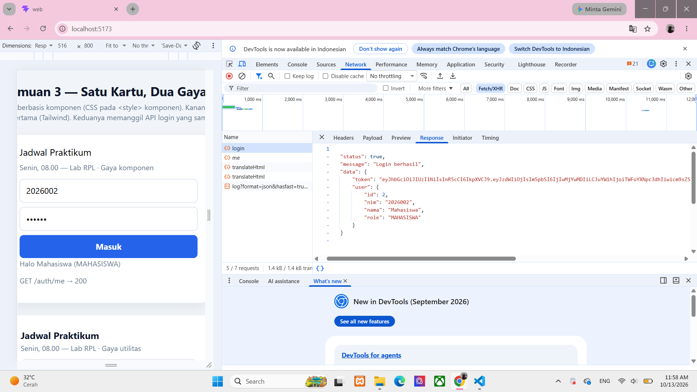
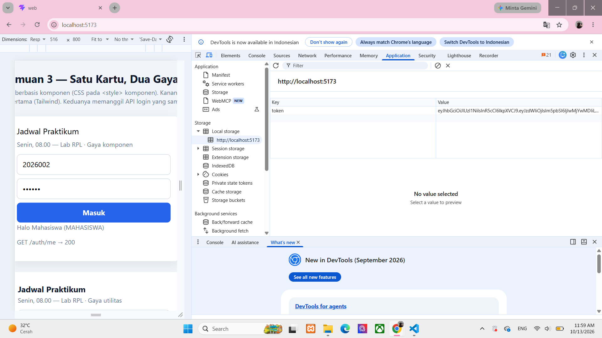
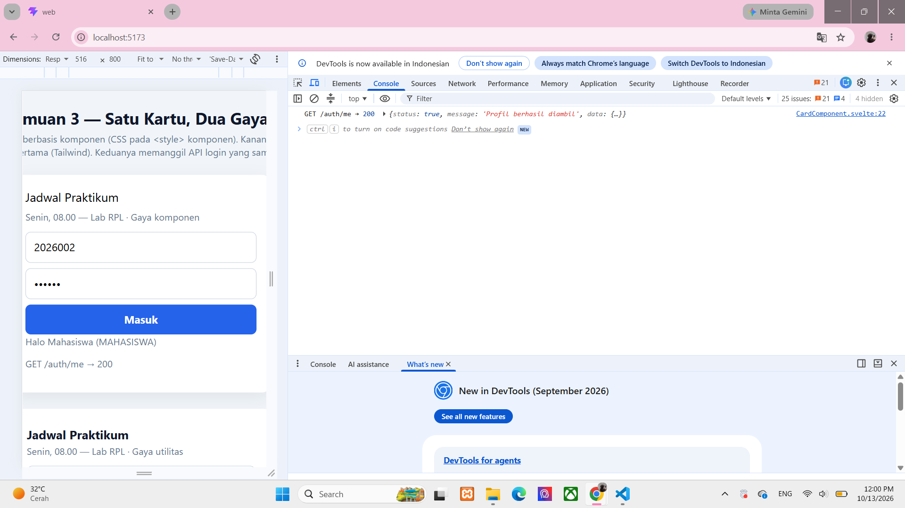
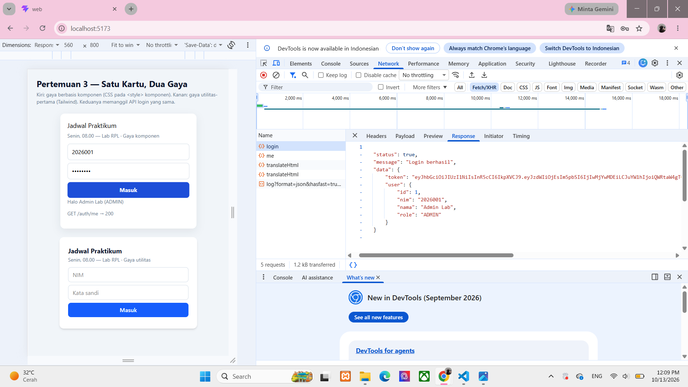
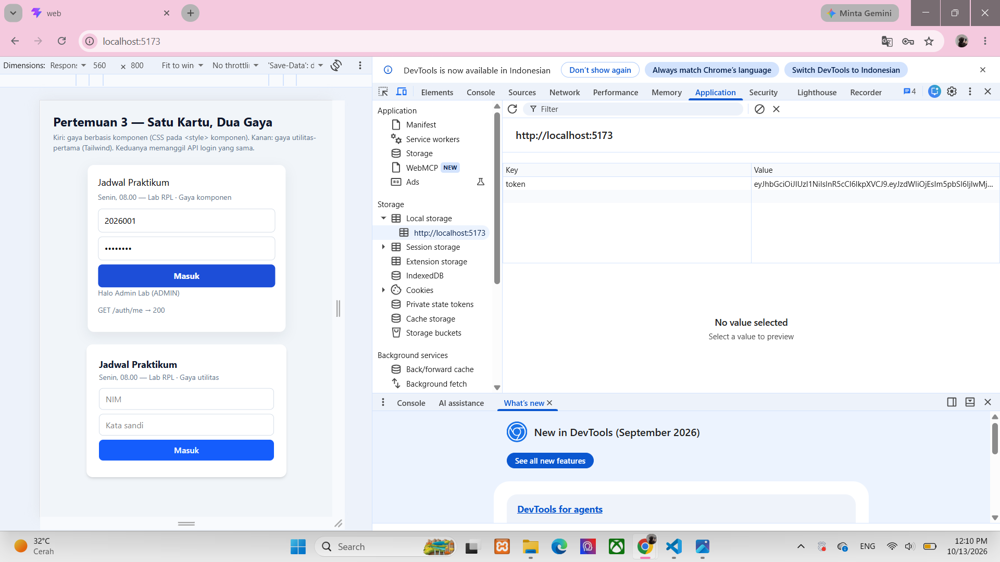
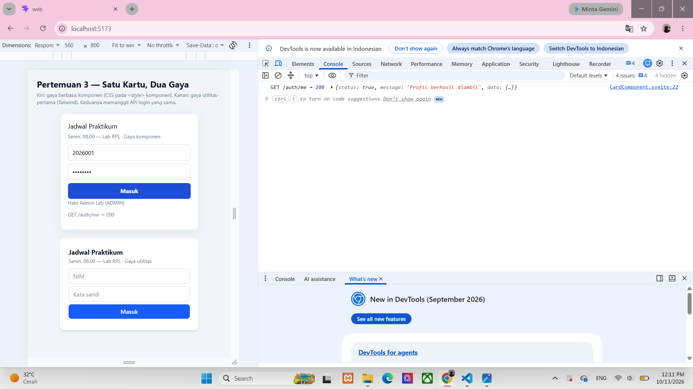

## Laporan Kegiatan 
Pada implementasi login JWT ini, token disimpan menggunakan `localStorage` agar dapat digunakan kembali ketika aplikasi mengakses route yang membutuhkan autentikasi. Namun, cara tersebut masih memiliki keterbatasan dari sisi keamanan karena token dapat diakses oleh JavaScript pada halaman yang sama. Oleh karena itu, untuk aplikasi produksi diperlukan pengamanan tambahan, seperti masa berlaku token yang singkat, perlindungan terhadap serangan XSS, serta mekanisme penyimpanan token yang lebih aman sesuai kebutuhan aplikasi.

## Bukti Screenshot
### 1. mahasiswa

 ### 2. admin

