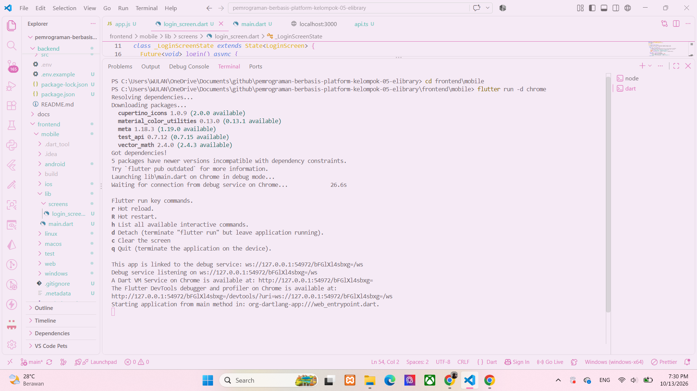
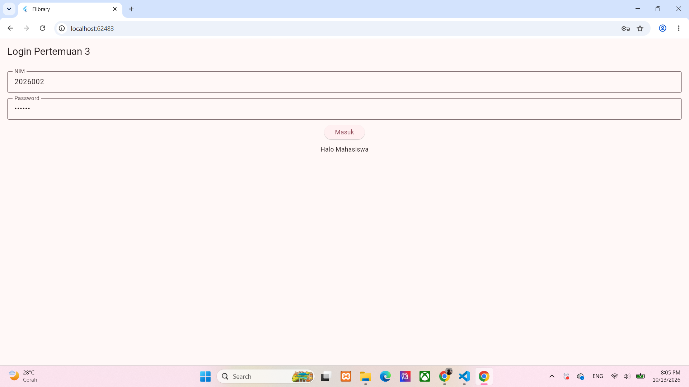

### Hasil Pengujian Login Aplikasi Mobile Elibrary

Pengujian dilakukan untuk memastikan bahwa aplikasi mobile Elibrary yang dibuat menggunakan Flutter dapat terhubung dengan backend Node.js Express dan menjalankan proses login dengan baik. Pengujian dilakukan melalui aplikasi yang dijalankan di Google Chrome dengan backend pada alamat `http://localhost:3000`.

**1. Pengujian Koneksi Aplikasi dengan Backend**

Pada pengujian ini, aplikasi Flutter dijalankan melalui Chrome dan backend dijalankan menggunakan perintah `npm.cmd run dev`. Setelah backend aktif, aplikasi dapat mengirimkan permintaan login ke endpoint `POST /api/v1/auth/login`. Sebelumnya, terdapat kendala koneksi yang disebabkan oleh konfigurasi CORS. Setelah konfigurasi tersebut diperbaiki, aplikasi berhasil terhubung dengan backend.

**2. Pengujian Login dengan Data yang Benar**

Pengujian dilakukan dengan memasukkan data berikut:

- NIM: `2026002`
- Password: `mhs123`

Setelah tombol **Masuk** ditekan, aplikasi mengirimkan data login ke backend. Backend kemudian memeriksa kecocokan NIM dan password dengan data pengguna yang tersedia. Hasil pengujian menunjukkan bahwa aplikasi menampilkan pesan **“Halo Mahasiswa”**. Dengan demikian, proses login menggunakan data yang benar berhasil dilakukan.

**3. Pengujian Respons Backend**

Backend menyediakan endpoint login yang mengembalikan respons dalam format JSON. Ketika login berhasil, respons mencakup informasi token dan data pengguna, seperti ID, NIM, nama, dan peran pengguna. Aplikasi mengambil nama pengguna dari respons tersebut untuk menampilkan pesan sapaan. Hasil ini menunjukkan bahwa aplikasi dapat menerima dan mengolah respons dari backend.

**4. Pengujian Tampilan Aplikasi**

Tampilan aplikasi menampilkan halaman login dengan kolom NIM, kolom password, dan tombol Masuk. Kolom password menggunakan fitur penyamaran teks agar karakter yang dimasukkan tidak langsung terlihat. Ketika proses login berlangsung, tombol berubah menjadi tulisan “Memproses...”. Setelah respons diterima, aplikasi menampilkan hasil login kepada pengguna.

**5. Kesimpulan Pengujian**

Berdasarkan pengujian yang telah dilakukan, fitur login aplikasi mobile Elibrary berhasil dijalankan menggunakan Flutter dan backend Node.js Express. Aplikasi dapat mengirimkan data login, menerima respons dari backend, serta menampilkan nama pengguna setelah proses autentikasi berhasil. Kendala koneksi yang terjadi sebelumnya dapat diatasi dengan memperbaiki konfigurasi CORS. Pengujian ini membuktikan bahwa proses login dasar telah berjalan sesuai dengan hasil yang diharapkan.

**6. Bukti Pengujian**

