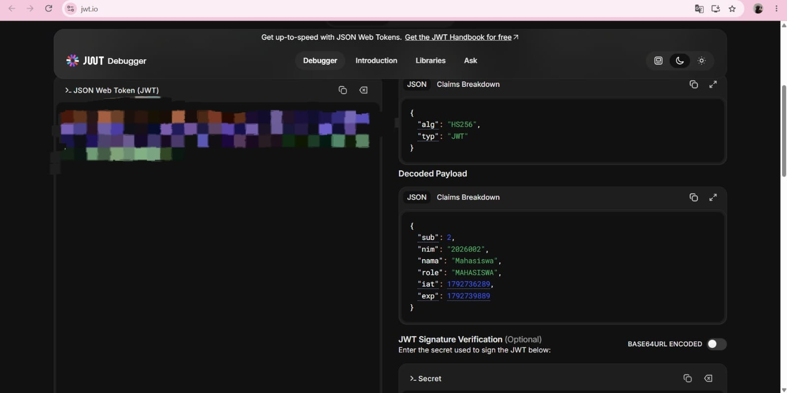
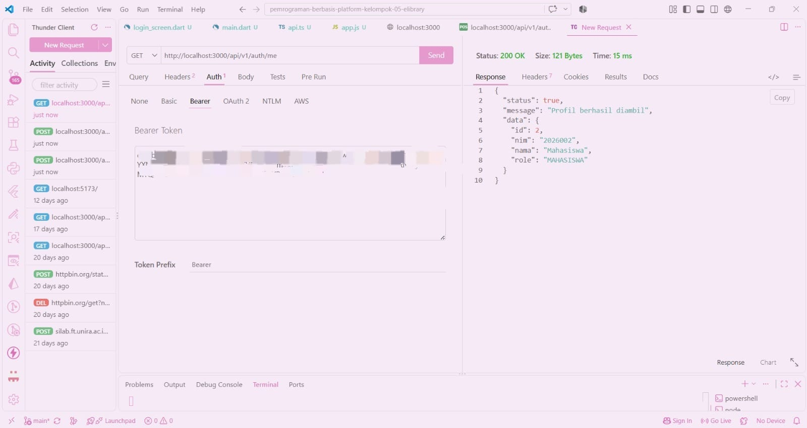
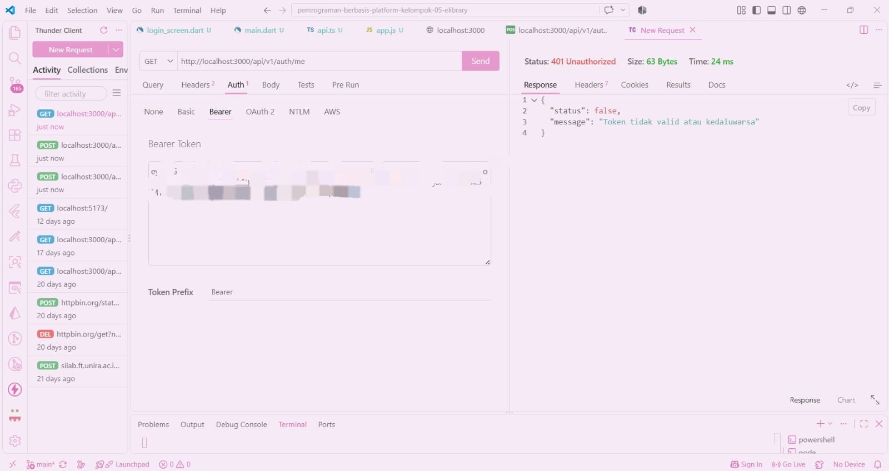

# Tugas Mandiri 4 — Analisis Struktur dan Validitas JWT
## 1. Token 

## 2. Analisis Klaim pada Payload JWT
a. Klaim yang mengidentifikasi pengguna adalah sub, yang menunjukkan identitas utama pengguna dalam token. Selain itu, klaim `nim` dapat menunjukkan Nomor Induk Mahasiswa jika tersedia dalam payload.

b. Klaim yang digunakan untuk memeriksa peran pengguna adalah role. Klaim ini menunjukkan peran pengguna, misalnya `MAHASISWA` atau `ADMIN`, sehingga server dapat menentukan hak aksesnya.

c. Klaim waktu penerbitan dan kedaluwarsa token adalah iat dan exp. Klaim `iat` menunjukkan waktu ketika token diterbitkan oleh server, sedangkan `exp` menunjukkan batas waktu token dapat digunakan. Jika waktu kedaluwarsa sudah terlewati, token tidak dapat digunakan lagi apabila server memeriksa masa berlakunya.

## 3. Payload Token JWT 200 dan 401
#### a. Token JWT 200

#### b. Token JWT 401

Perubahan payload menyebabkan verifikasi (signature) gagal karena signature dibuat berdasarkan header dan payload asli menggunakan kunci rahasia server. Ketika payload diubah, signature tidak lagi cocok dengan isi token tersebut. Oleh karena itu, server menolak token yang telah dimodifikasi.

## 4. Tabel Hasil Pengujian
| Token yang diuji | Endpoint | Hasil yang diharapkan | Hasil pengujian saya |
|---|---|---|---|
| Token asli yang masih berlaku | `GET /auth/me` | `200` | `200 OK` — jika server menampilkan respons berhasil |
| Token dengan payload yang diubah tanpa memperbarui tanda tangan | `GET /auth/me` | `401` | `401 Unauthorized` — jika server menolak token yang diubah |
