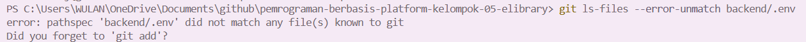
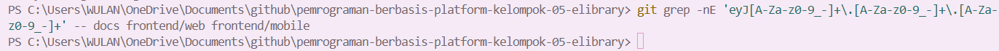

# Tugas Mandiri 5 — Membandingkan Hashing dan Enkripsi serta Menjaga Kunci Rahasia

## 1. Hasil Percobaan Hashing
| Percobaan | Kata sandi masukan | Nilai hash |
|---|---|---|
| Pertama | `sama` | `$2a$10$43pG74BnlxYd8lxCQIL29.lhrouwD6a99ykLOlPSuGL5zpp.7wGGW` |
| Kedua | `sama` | `$2a$10$IJujQgS3UW776SND7MS5duZ8oZDDvrHEvqmKPoM3kTk1Dv.1U35p2` |

Kedua percobaan menghasilkan hash yang berbeda meskipun menggunakan kata sandi yang sama karena bcrypt menggunakan salt acak pada setiap proses hashing. Cost 10 menentukan tingkat biaya komputasi bcrypt, yaitu sekitar 2¹⁰ atau 1.024 unit kerja iteratif; semakin tinggi cost, semakin lama proses hashing dan pemeriksaan kata sandi.

## 2. Jawaban Pertanyaan
### a. Apa perbedaan hashing dan enkripsi dalam hal pemulihan data asli?
Hashing mengubah data menjadi nilai hash dan tidak dirancang untuk mengembalikan data asli. Sebaliknya, enkripsi memungkinkan data asli dipulihkan melalui proses dekripsi menggunakan kunci yang sesuai.

### b. Mengapa aplikasi menyimpan hash kata sandi untuk memverifikasi login?
Aplikasi menyimpan hash agar kata sandi asli tidak tersimpan secara langsung di database. Saat login, kata sandi yang dimasukkan diperiksa terhadap hash yang tersimpan sehingga keamanan akun lebih terjaga jika database bocor.

### c. Bagaimana `bcrypt.compare` memeriksa kecocokan kata sandi tanpa menyimpan kata sandi asli?
bcrypt.compare memproses kata sandi yang dimasukkan menggunakan salt dan parameter yang tersimpan dalam hash, lalu membandingkan hasilnya. Fungsi ini mengembalikan true jika cocok dan false jika tidak cocok, tanpa perlu menyimpan kata sandi asli.

### d. Apa yang dimaksud dengan rainbow table dan bagaimana salt mengurangi efektivitasnya?
Rainbow table adalah kumpulan perhitungan hash yang telah dibuat sebelumnya untuk membantu menebak data asli dari nilai hash. Salt membuat hash dari kata sandi yang sama dapat berbeda sehingga tabel yang telah dihitung sebelumnya menjadi kurang efektif.

### e. Mengapa pengembang harus menjaga kerahasiaan JWT_SECRET dan mencegah nilainya tersimpan dalam riwayat Git?
JWT_SECRET digunakan untuk menandatangani dan memverifikasi token JWT, sehingga jika bocor, pihak lain berpotensi membuat token palsu yang valid. Secret harus dijaga dan tidak disimpan dalam riwayat Git karena menghapusnya dari versi terbaru saja tidak otomatis menghilangkan nilainya dari riwayat commit sebelumnya.

## 3. Hasil Pemeriksaan Repositori
### a. Pemeriksaan berkas `.env`
Perintah pemeriksaan yang digunakan:

Hasil pemeriksaan: AMAN: .env tidak terlacak. Berkas `backend/.env` tidak ditemukan dalam daftar berkas yang dilacak Git. Karena itu, berkas tersebut tidak sedang dilacak Git pada repositori yang diperiksa.

### b. Pemeriksaan token JWT
Perintah pemeriksaan yang digunakan:

Hasil pemeriksaan: Tidak ditemukan kecocokan pola token JWT pada folder docs, frontend/web, dan frontend/mobile yang diperiksa.
