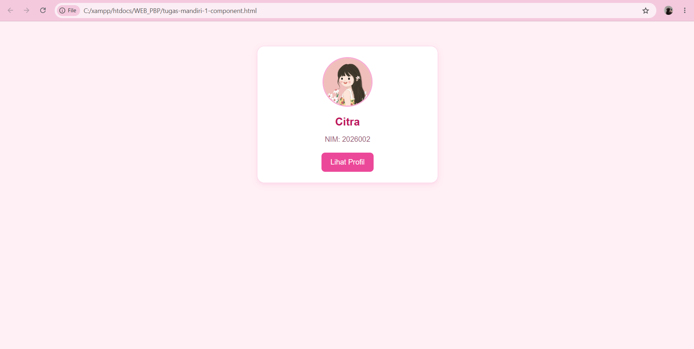
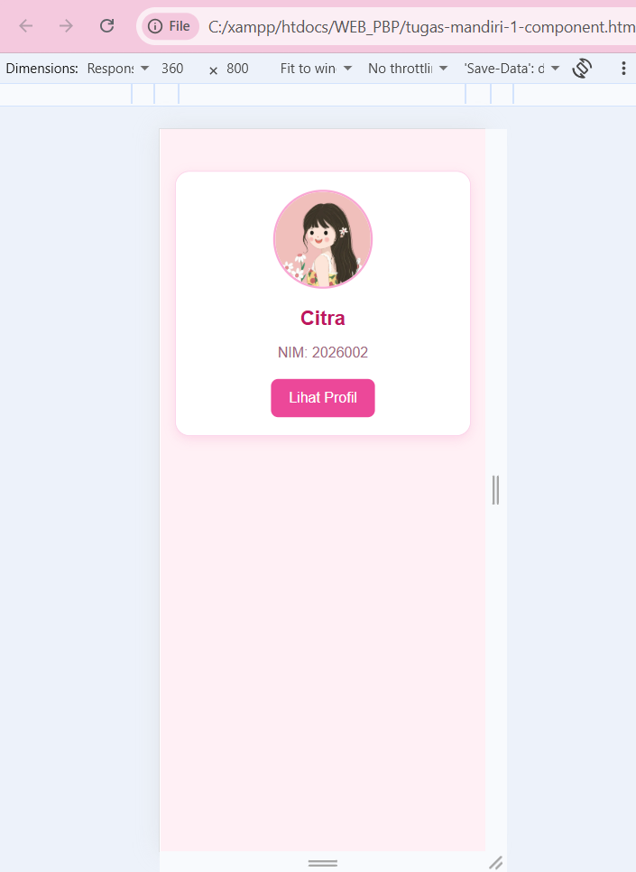
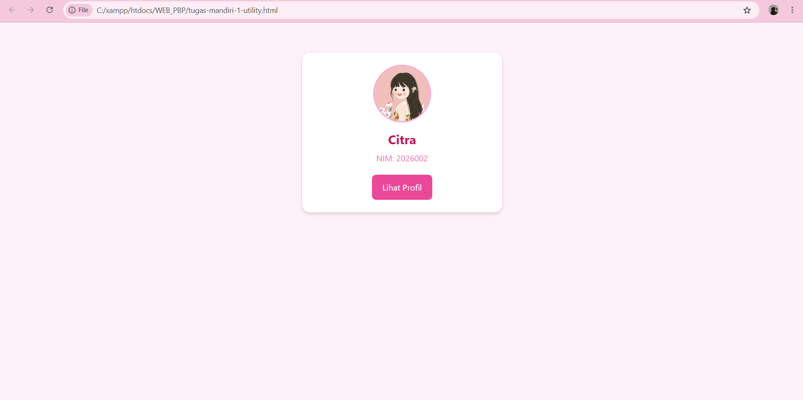
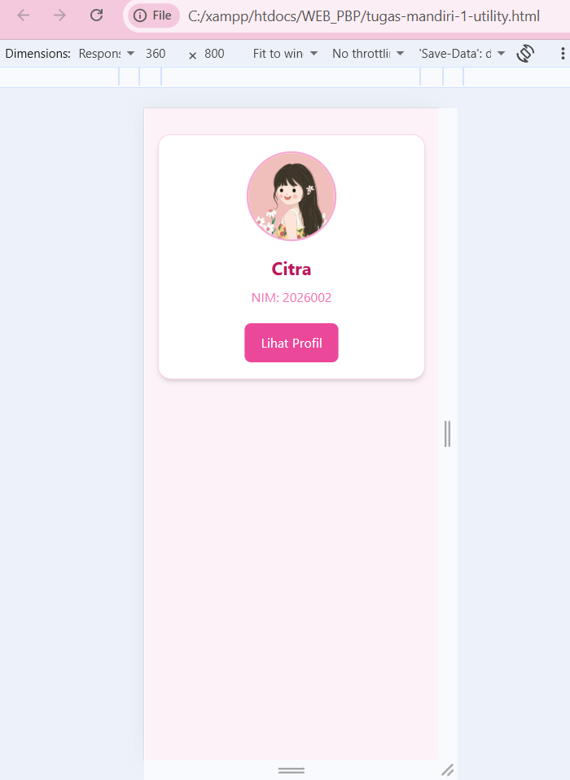

## Perbandingan Component-Based dan Utility-First
### 1. Hasil Pengerjaan
Saya membuat dua halaman kartu profil dengan isi yang sama, yaitu foto, nama lengkap, NIM, dan tombol 
Lihat Profil. Perbedaannya terletak pada cara mengatur tampilan halaman. Pada pendekatan component-
based, saya menggunakan CSS di dalam tag <style> dan membuat class seperti .card, .card-photo, dan 
.btn. Sementara itu, pada pendekatan utility-first, saya menggunakan Tailwind CSS dengan class utility 
secara langsung pada elemen HTML.

### 2. Perbandingan Kedua Pendekatan
| Aspek | Component-Based | UUtility-First |
|---|---|---|
| Cara mengatur tampilan | Menggunakan aturan CSS sendiri | Menggunakan class utility Tailwind |
| Jumlah Baris CSS | Dicatat dari bagian <style> | Tidak menulis CSS sendiri |
| Jumlah class | Menggunakan class komponen | Menggunakan banyak class utility |
| Waktu pengerjaan | Perlu waktu untuk menulis aturan CSS | Cenderung lebih cepat untuk tampilan sederhana | 
| Perubahan warna | Mengubah aturan CSS pada class | Mengganti class warna |
| Penggunaan ulang | Cocok untuk komponen yang memiliki tampilan seragam | Praktis untuk menyusun tampilan langsung di HTML |

### 3. Hasil Pengamatan
Menurut hasil percobaan saya, pendekatan component-based membuat kode CSS lebih teratur karena 
aturan tampilan dikumpulkan dalam class tertentu. Ketika ingin mengubah tema kartu, saya cukup 
mengubah aturan CSS pada class yang digunakan bersama. Sementara itu, pendekatan utility-first 
memudahkan saya mengatur warna, jarak, ukuran, dan bentuk elemen secara langsung melalui class pada 
HTML. Namun, jumlah class yang digunakan bisa membuat kode HTML terlihat lebih panjang.
Dari segi waktu pengerjaan, versi utility-first dapat dibuat lebih cepat karena saya tidak perlu 
menulis aturan CSS dari awal. Sebaliknya, versi component-based membutuhkan waktu untuk menyusun 
aturan CSS terlebih dahulu, tetapi lebih mudah dikelola ketika tampilan yang sama digunakan pada 
beberapa komponen. Dengan demikian, kedua pendekatan memiliki kelebihan masing-masing, baik dari 
segi waktu pengerjaan maupun kemudahan perubahan tema.

### 4. Pilihan Untuk Proyek Akhir
Untuk halaman yang mempunyai banyak komponen dengan desain seragam, saya memilih component-based 
karena aturan CSS dapat digunakan kembali dan lebih mudah dikelola. Untuk halaman yang membutuhkan 
penyusunan tampilan dengan cepat, saya memilih utility-first karena pengaturan tampilan dapat 
dilakukan langsung pada elemen HTML. Pilihan tersebut tetap disesuaikan dengan kebutuhan halaman 
dan kemudahan pemeliharaan kode.

### 5. Kesimpulan 
Kedua pendekatan dapat digunakan untuk membuat kartu profil yang responsif. Component-based lebih 
berfokus pada penggunaan class dan aturan CSS yang dibuat sendiri, sedangkan utility-first 
mengandalkan class siap pakai. Dari tugas ini, saya dapat memahami bahwa pemilihan pendekatan 
sebaiknya mempertimbangkan kecepatan pengerjaan, konsistensi desain, dan kemudahan pengembangan 
selanjutnya.

## Bukti Sreenshot
### A. Component - Laptop

### B. Componet - 360px

### C. Utility - Laptop

### D. Utility - 360px

